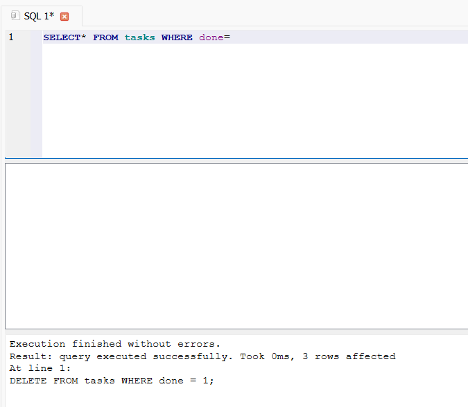

# Task CRUD API

A JavaScript CRUD API built with Express and SQLite (`better-sqlite3`). The database is created and seeded automatically when the app starts for the first time.

## Why SQLite?

SQLite stores the data in a local file and does not need a separate database server. It is a good fit for this small project and keeps setup simple.

## Database file

The app opens `tasks.db` in the project folder when you run it from this directory. `database.js` creates the `tasks` table and inserts three example tasks if the table is empty. The database file is ignored by Git, so a fresh clone creates its own database on first run.

## Start the project

Install [Node.js 22 or newer](https://nodejs.org/), then run these commands from the project folder:

```bash
npm install
npm start
```

The API runs at <http://localhost:3000>. Interactive API documentation is at <http://localhost:3000/docs>.

## Endpoints

| Method | Path | Description | Success status |
| --- | --- | --- | --- |
| GET | `/` | Describe the API | 200 |
| GET | `/health` | Check server health | 200 |
| GET | `/tasks` | List all tasks | 200 |
| GET | `/tasks/:id` | Get one task | 200 |
| POST | `/tasks` | Create a task with `{ "title": "Buy milk" }` | 201 |
| PUT | `/tasks/:id` | Replace a task; send `title` and `done` | 200 |
| PATCH | `/tasks/:id` | Partially update `title`, `done`, or both | 200 |
| DELETE | `/tasks/:id` | Delete a task | 204 |

Unknown task IDs return 404. Invalid task data returns 400. The API converts SQLite's `0` and `1` values for `done` to JSON `false` and `true`.

## Example SQL query

This query was run against `tasks.db`:

```sql
SELECT id, title, done FROM tasks;
```

It returned the three seeded rows:

```text
1 | Learn Express | 0
2 | Build a CRUD API | 0
3 | Try Swagger UI | 1
```

## SQLite viewer screenshot



